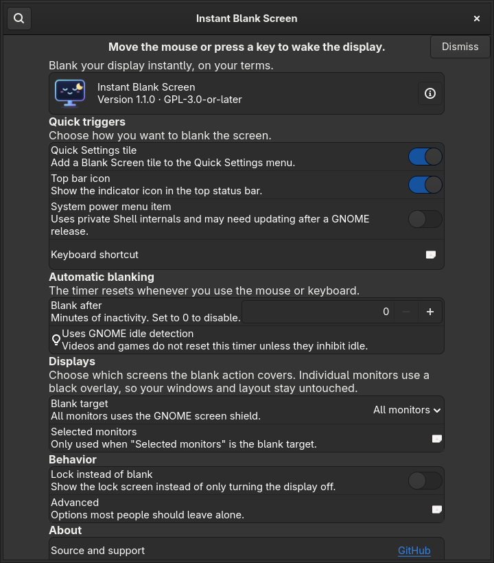
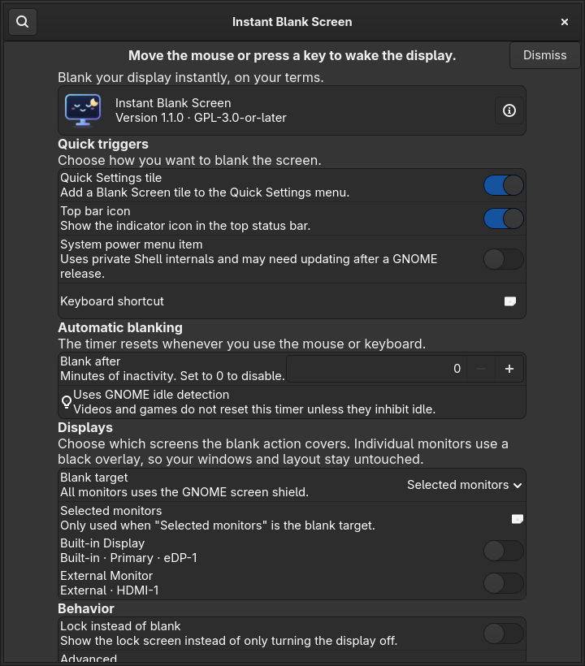

<div align="center">
  
  <h1>Instant Blank Screen</h1>
  <p><strong>Instantly blank your display — one monitor or all of them — from GNOME Shell.</strong></p>
  <p>
    <a href="https://github.com/crastatelvin/gnome-shell-instant-blank/releases/latest"></a>
    <a href="https://extensions.gnome.org/extension/12018/instant-blank-screen/"></a>
    
    <a href="COPYING"></a>
  </p>
  <p>
    
    
    
    
  </p>
</div>

---

## Screenshots

<p align="center">
  
  
</p>
<p align="center"><em>Preferences window — general options and per-monitor targeting.</em></p>

## Why another blank-screen extension?

GNOME has an automatic blank timer, but no built-in **instant, on-demand** blank button that works natively on Wayland. The common workaround — a custom command calling `xset dpms force off` — is X11-only, needs a package that may not be installed, and spawns a subprocess from the Shell.

This extension does it properly: native D-Bus calls, a Quick Settings tile, a panel icon, an optional power-menu entry, a global shortcut, per-monitor targeting, and an independent idle timer. No subprocesses, no X11 tools, no bundled binaries.

## Features

| Feature | What it does |
|---|---|
| **Quick Settings tile** | A "Blank Screen" toggle in the Quick Settings grid. |
| **Top bar icon** | A display indicator next to the system status area. |
| **Keyboard shortcut** | Configurable accelerator (for example `<Super>b`). |
| **Power menu item** | Optional entry in GNOME's system menu (private API, opt-in). |
| **Multi-monitor targets** | All monitors, primary only, external only, or a selected subset. |
| **Auto-blank** | Blank after N minutes of real inactivity; `0` disables it. |
| **Wake on input** | Move the mouse or press a key — no password prompt by default. |
| **Lock mode** | Optional "lock instead of blank" using the GNOME lock screen. |
| **Hard DPMS** | Advanced mode driving Mutter's `PowerSaveMode` directly. |

It deliberately does **not** change `idle-delay`, `lock-enabled`, or any other global GNOME setting.

## How it works

### Instant blanking

The default action calls `org.gnome.ScreenSaver.SetActive(true)` on the session bus. On GNOME Wayland this engages the screen shield and drives Mutter's `PowerSaveMode` to `3` (full display-off). Because `lock-enabled` is left alone, it blanks without a password prompt and GNOME wakes it on activity.

### Multi-monitor reality

Mutter exposes only a **global** `PowerSaveMode`; there is no supported per-monitor DPMS API on Wayland. Therefore:

- **All monitors** → GNOME screen shield (covers every display, global DPMS).
- **Primary / external / selected** → black overlay actors sized to each monitor's geometry. Windows and layout stay untouched; global DPMS is engaged only when every connected monitor is covered, then restored on wake.

Monitor names and connectors come from Mutter and are listed in Preferences for selection.

### Automatic blanking

The extension uses `global.backend.get_core_idle_monitor()` with `add_idle_watch()` and `add_user_active_watch()` — the same Mutter idle mechanism GNOME Shell itself uses. The countdown resets automatically on real mouse/keyboard input; a plain wall-clock timer would not.

## Installation

### From extensions.gnome.org

Once the submitted version is approved, find **Instant Blank Screen** on [extensions.gnome.org](https://extensions.gnome.org/extension/12018/instant-blank-screen/) and flip the switch.

### From source

```bash
git clone https://github.com/crastatelvin/gnome-shell-instant-blank.git
cd gnome-shell-instant-blank
make install
gnome-extensions enable instant-blank@crastatelvin.github.io
```

Shell only scans the extension directory at startup, so **log out and back in** once after a source install. Open preferences with:

```bash
gnome-extensions prefs instant-blank@crastatelvin.github.io
```

## Compatibility

- GNOME Shell **51** (declared and tested).
- The APIs used (ESM `Extension`, `SystemIndicator` / `addExternalIndicator`, Mutter idle monitor, `ScreenSaver` D-Bus) are unchanged since GNOME 45; broader support will be declared after testing.

## Building and validating

```bash
make check    # metadata, JS syntax, strict GSettings schema compile
make build    # dist/instant-blank@crastatelvin.github.io.shell-extension.zip
```

The ZIP contains only the runtime JS, metadata, schema XML, translations, and the logo — no build scripts or compiled schemas.

## Translations

Gettext template: `po/instant-blank@crastatelvin.github.io.pot`.

```bash
cp po/instant-blank@crastatelvin.github.io.pot po/fr.po
# translate, then:
make build
```

## Contributing

Issues and pull requests are welcome at https://github.com/crastatelvin/gnome-shell-instant-blank. Please run `make check` before opening a PR.

## License

GPL-3.0-or-later — see [COPYING](COPYING). Logo and screenshots are part of the same project.
